  

  

  
  
  

### `> whoami`

I'm Abhay. I just graduated from VIT Bhopal and I spend most of my time in Python, building things with machine learning, LLMs and AI agents. I learn by shipping, so this profile is a mix of finished projects, hackathon builds and experiments I did in public.

### `> stack --list`

  
  
  
  
  
  
  
  
  
  
  

### `> stats --live`

  
  

  

  

### `> achievements`

  

  
  
  

### `> projects --featured`

  
  
  
  
  
  

### `> hackathons`

[FOSS Hack](https://github.com/INEcodes/FOSSHack) · [Smart India Hackathon](https://github.com/INEcodes/Image_Colorization_SIH) · [Nasscom](https://github.com/INEcodes/Nasscom_Hackathon_Team_Polici) · [Bolt](https://github.com/INEcodes/OneMoreRep)

  

